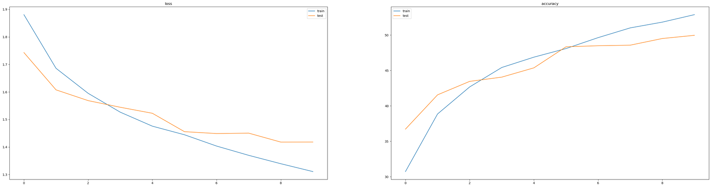
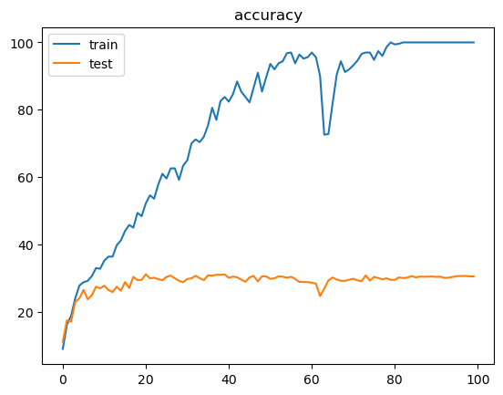

# Homework 1: Fully Connected Network on CIFAR-10

A fully connected (MLP) image classifier built in PyTorch, followed by an overfitting
study, a regularization attempt, and a KNN baseline.

## Dataset

CIFAR-10: 32×32 RGB images, 10 classes, 5,000 training and 1,000 test images per class
(50,000 train / 10,000 test).

## Model

Images are flattened to 3,072 features and passed through four linear layers with ReLU
between them:

```
3072 → 1024 → 512 → 256 → 10
```

Training: CrossEntropyLoss, Adam (lr = 0.001), batch size 64, 10 epochs.

## What's in the notebook

1. Dataset exploration (image size, number of classes, samples per class) and sample visualization
2. Fully connected network and training loop
3. Training and test curves
4. Evaluation: per-class accuracy and confusion matrix
5. KNN baseline
6. Overfitting demonstration and a regularization attempt

## Results

### Baseline MLP (10 epochs)

| | Loss | Accuracy |
|---|---|---|
| Train | 1.33 | 52.2% |
| Test | 1.45 | 48.8% |



**Per-class test accuracy**

| Class | Acc. | Class | Acc. |
|---|---|---|---|
| ship | 66.8% | frog | 50.6% |
| automobile | 61.9% | deer | 46.8% |
| horse | 60.5% | dog | 37.9% |
| airplane | 57.5% | bird | 35.2% |
| truck | 53.1% | cat | 29.3% |

Animals with similar shapes and textures (cat, dog, bird, deer) are the hardest for an
MLP, while vehicles with distinctive silhouettes are easier.

### Activation function and batch size (10 epochs)

| Experiment | Train acc. | Test acc. |
|---|---|---|
| ReLU | 52.95% | 50.36% |
| Sigmoid | 44.85% | 42.27% |
| Batch size 128 | 53.39% | 50.20% |
| Batch size 256 | 53.04% | 51.09% |
| Batch size 512 | 51.69% | 48.67% |

### Overfitting demonstration (500 training images, 100 epochs)

| | Loss | Accuracy |
|---|---|---|
| Train | 0.004 | 100% |
| Test | 5.69 | 30.5% |



The network memorizes the 500 training images perfectly while test accuracy stays at
about 30%, and the test loss keeps growing.

### Regularization attempt

Adam with `weight_decay = 0.1` was too strong: the network stopped learning (train accuracy
about 13%, test accuracy 10%, which is chance level for 10 classes). This is
underfitting rather than a fix for overfitting. Weight decay values far smaller than 0.1,
dropout, or early stopping are the right tools here.

### KNN baseline

KNN on the flattened images reaches **33.0%** test accuracy.

## Key takeaways

- **ReLU beats Sigmoid.** Sigmoid squashes values into (0, 1), so gradients shrink and learning slows down.
- **Batch size:** larger batches shortened training time, with little change in accuracy (best at 256, worse at 512).
- **Overfitting:** with little data the MLP reaches 100% training accuracy but only about 30% on the test set.
- **Regularization strength matters:** too much weight decay prevents learning entirely.
- **MLP vs KNN:** the MLP is clearly more accurate (≈ 50% vs ≈ 33%), but KNN needs no training and has very few hyperparameters.

## Run it

```bash
pip install torch torchvision matplotlib numpy scikit-learn
jupyter notebook
```

Open the notebook in this folder. CIFAR-10 is downloaded automatically by `torchvision` on the first run.
