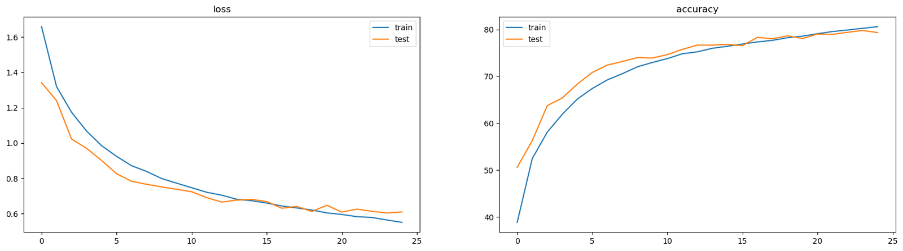
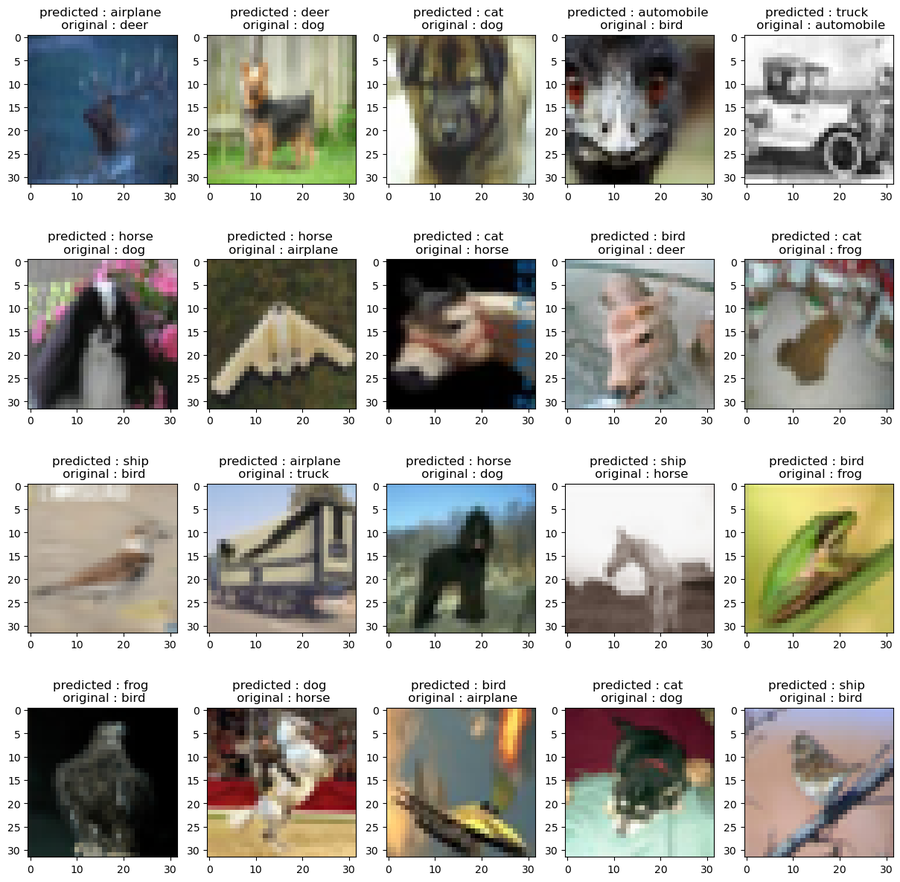
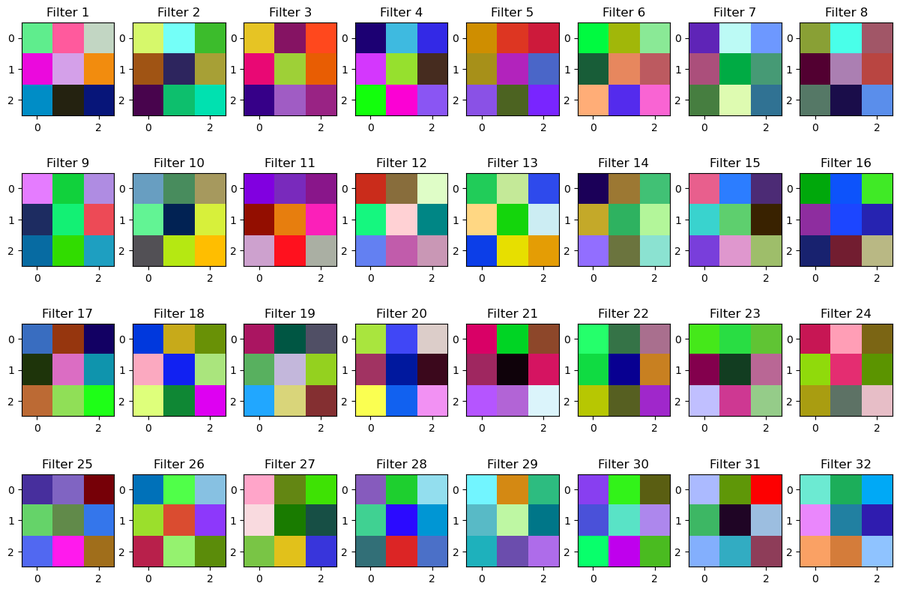
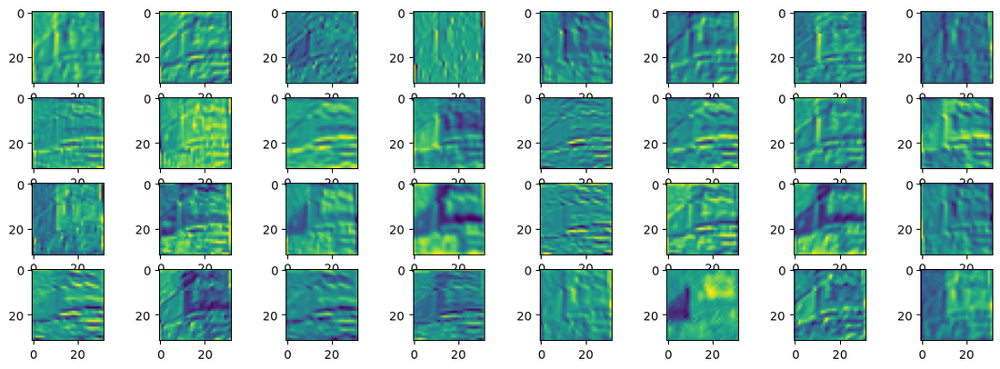

# Homework 2: Convolutional Neural Networks on CIFAR-10

Building and analyzing CNNs from scratch in PyTorch: feature maps, architecture
experiments, regularization, and a comparison with the fully connected network
from Homework 1.

## Dataset

CIFAR-10 (32×32 RGB images, 10 classes, 50,000 train / 10,000 test).

## What's in the notebook

1. **Convolution basics:** a single `Conv2d` layer (3 → 8 channels, kernel 3, padding 1), feature-map visualization, and the effect of kernel size (3, 5, 7) and number of filters (8, 16, 32)
2. **CNN from scratch:** parameter count and output-shape check
3. **Training:** Adam, CrossEntropyLoss, batch size 128, 25 epochs, loss and accuracy curves
4. **Experiments:** number of filters, ReLU vs LeakyReLU, BatchNorm, Dropout
5. **Overfitting:** 2,000-sample subset, with Dropout, data augmentation, and early stopping
6. **Evaluation:** test accuracy, per-class accuracy, confusion matrix, misclassified examples
7. **Visualization:** first-layer filters and feature maps

## Results

### Main CNN (25 epochs)

Final epoch: train accuracy 80.6%, validation accuracy 79.3% (loss 0.55 / 0.61). The two
curves stay close together, so this model barely overfits.



**Test accuracy: 78.75%**

| Class | Acc. | Class | Acc. |
|---|---|---|---|
| truck | 90.0% | horse | 80.0% |
| ship | 89.5% | deer | 79.4% |
| airplane | 83.7% | cat | 71.6% |
| frog | 83.4% | bird | 70.0% |
| automobile | 82.9% | dog | 57.0% |

The most common mistake is **dog → cat**: 264 of the 1,000 test dogs were predicted as cats.



### Architecture experiments (10 epochs)

| Experiment | Train acc. | Test acc. |
|---|---|---|
| Filters 16–32–64 | 79.8% | 71.95% |
| Filters 64–128–256 | 89.3% | 75.3% (overfits) |
| LeakyReLU | 92.75% | 74.15% |
| ReLU | 88.33% | 74.0% |
| BatchNorm | 92.48% | 76.38% |
| Dropout (0.5) | 79.3% | 75.3% |

### Small-subset overfitting study (2,000 training samples, 25 epochs)

| Method | Train acc. | Test acc. |
|---|---|---|
| No regularization | 86% | 50% |
| Dropout | 75% | 51% |
| Data augmentation | 65% | 51% |
| Early stopping | 80% | 47% |
| All combined | 57% | 49.7% |

With so little data, the techniques mainly **narrowed the gap between training and
test accuracy** rather than raising test accuracy. Data augmentation was the most
effective single method.

### CNN vs MLP

| | MLP (HW1) | CNN |
|---|---|---|
| Test accuracy after 10 epochs | ≈ 50% | ≈ 75% |
| Training time for 10 epochs | 2 min 50 s | 3 min 40 s |

## What the CNN learns

First-layer filters (3×3 kernels) and feature maps from the convolutional layers:





Early layers respond to edges and simple textures; deeper layers respond to larger
object parts and shapes.

## Key takeaways

- **Kernel size:** with padding 1, a 3×3 kernel keeps the size at 32×32, 5×5 gives 30×30, and 7×7 gives 28×28. Small kernels highlight edges; large kernels capture broader shapes.
- **More filters** extract more features but raise the risk of overfitting.
- **BatchNorm** gave the best accuracy in the architecture experiments, and **Dropout** gave the smallest train–test gap.
- **CNNs vs MLPs:** CNNs share weights across the image and look at local patches, so they need far fewer parameters and generalize much better on images.

## Run it

```bash
pip install torch torchvision matplotlib numpy
jupyter notebook
```

Open the notebook in this folder. CIFAR-10 is downloaded automatically by `torchvision` on the first run.
