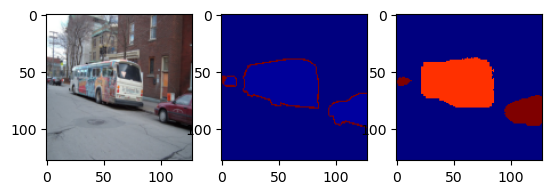

# Homework 3: Semantic Segmentation with a CNN

A fully convolutional encoder–decoder network for semantic segmentation on
Pascal VOC, built in PyTorch with custom convolution and transposed-convolution blocks.

## Dataset

Pascal VOC 2007 segmentation split, loaded with `torchvision.datasets.VOCSegmentation`:
**209 training images**, 21 classes (20 object classes + background). Original images
(for example 281×500) are resized to **128×128**, with bilinear interpolation for images and
nearest-neighbor for masks so class labels are not blended. Batch size is 16.

## Model

A fully convolutional network with no fully connected layers. Output shape: `[batch, 21, 128, 128]`,
one score per class for every pixel.

```
Encoder   Conv(3→64, stride 2)                     128 → 64
          Conv(64→128) · Conv(128→128, stride 2)   64 → 32
          Conv(128→256) · Conv(256→256) · Conv(256→256, stride 2)   32 → 16
          Conv(256→512) · Conv(512→512)

Decoder   ConvTranspose(512→256) + 2 Conv          16 → 32
          ConvTranspose(256→128) + 1 Conv          32 → 64
          ConvTranspose(128→64)                    64 → 128
          1×1 Conv(64→21)
```

Every convolution block is `Conv3×3 → BatchNorm → ReLU`. Downsampling uses stride-2
convolutions and upsampling uses transposed convolutions.

## Training

- Loss: pixel-wise `CrossEntropyLoss` (`ignore_index=255` to skip VOC's "void" boundary pixels)
- Optimizer: Adam, learning rate 0.001
- 200 epochs

| Epoch | Training loss |
|---|---|
| 1 | 0.709 |
| 10 | 0.758 |
| 50 | 0.483 |
| 100 | 0.285 |
| 200 | 0.130 |

In the first epochs the loss barely moves, because predicting "background" everywhere already
scores well on VOC. As training continues, the loss falls steadily and the network learns to
separate objects from the background.

## Qualitative result

Input image, ground-truth mask, and prediction (a training image):



The network reproduces the shapes of the bus and the car. Colors differ between the two mask
panels because each panel is scaled independently, and the ground truth also contains a thin
boundary class (255).

## Limitations

- Results are shown on training images only: there is no validation split, and no mIoU or pixel-accuracy metrics yet.
- With only 209 training images, a low training loss partly reflects memorization.

## Concepts covered

- **Mask values:** each pixel holds a class index from 0 to 20.
- **Segmentation vs classification:** classification labels the whole image; segmentation labels every pixel and locates objects.
- **No fully connected layers:** they destroy spatial structure, which pixel-level prediction depends on, and are computationally expensive.
- **Removing downsampling (pooling):** shrinks the receptive field and greatly increases memory and compute.
- **Removing skip connections:** hurts gradient flow in deep networks and loses low-level detail in the output.

## Run it

```bash
pip install torch torchvision matplotlib numpy
jupyter notebook
```

Open the notebook in this folder. Download the VOC 2007 dataset into `./data` first
(set `download=True` in `VOCSegmentation` to fetch it automatically).
