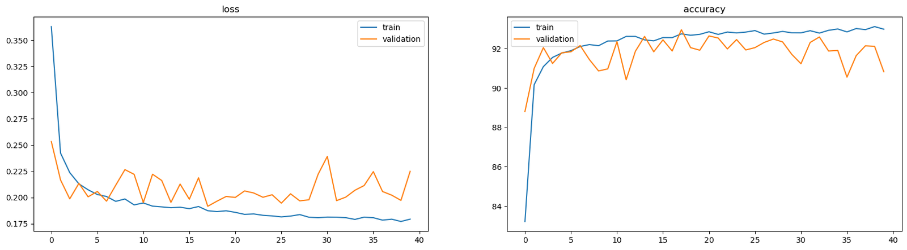
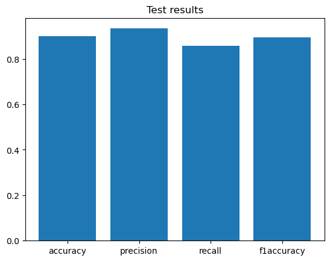

# Final Project: Brain Tumor Detection from MRI with a CNN

A PyTorch reproduction of the CNN-based brain tumor detection approach from the paper
included in this folder, trained and evaluated on the BraTS 2020 dataset. This is a
simplified version of my bachelor's thesis, which tackles the harder problem of 3D tumor
segmentation with a 3D U-Net on BraTS 2021.

## Task

Binary classification of 2D MRI slices: **does this slice contain a tumor?**

- Input: one axial FLAIR slice (240×240, grayscale)
- Label: 1 if the slice contains any tumor voxel in the ground-truth segmentation, otherwise 0

## Dataset

BraTS 2020 training set (FLAIR modality). The dataset itself is not included in this repository.

| | |
|---|---|
| Cases used | 368 (case 355 has no segmentation file and was skipped) |
| Slices | 50,706 (empty all-black slices removed) |
| Train / validation / test | 35,504 / 7,586 / 7,616 slices |

**The split is done by patient, not by slice** (about 70% / 15% / 15%, fixed seed). Neighboring
slices of the same brain look almost identical, so a random slice-level split would leak
near-duplicates into the test set and inflate the results.

## Method

**Preprocessing:** per-slice z-score normalization.
**Augmentation (training only):** random horizontal flip, vertical flip, and rotation up to ±10°.

**Model:** five convolution blocks followed by a small classifier.

```
Input 1×240×240
→ 5 × [ Conv3×3 → ReLU → MaxPool2×2 ]   filters: 16, 32, 64, 64, 64
→ Flatten (64×7×7 = 3136)
→ Linear 512 → ReLU → Dropout 0.5
→ Linear 2
```

**Training:** CrossEntropyLoss, Adam (lr = 0.001, weight decay = 5e-4), batch size 16, 40 epochs.
The paper's settings were used for the architecture, optimizer, learning rate, and batch size;
dropout and weight decay were added for regularization.

## Results

### Training



Training accuracy reaches about 93% and validation accuracy fluctuates between 90% and 93%
(best: 92.96% at epoch 18).

### Test set (7,616 slices)

| Metric | Value |
|---|---|
| Accuracy | 90.05% |
| Precision | 93.36% |
| Recall | 85.66% |
| F1 score | 89.34% |
| Loss | 0.234 |



Precision is higher than recall: the model rarely raises false alarms, but it misses about
14% of the slices that contain a tumor. The reported test numbers use the model after the last
epoch, not the best validation epoch.

## Comparison with the paper

The paper reports 98.49% accuracy on BraTS 2020. This reproduction reaches 90.05%. The setups
differ in several ways that probably explain most of the gap:

- **Patient-level split:** no slices of a test patient appear in training, which is a stricter test.
- **Single modality:** FLAIR slices at 240×240, instead of the paper's 300×300 grayscale images.
- **Simpler preprocessing:** no median filtering or high-pass edge enhancement; milder augmentation (flips and ±10° rotations).
- **Training setup:** a fixed train/validation/test split with cross-entropy loss, instead of 10-fold cross-validation with focal loss.

## Run it

```bash
pip install torch torchvision nibabel numpy pandas matplotlib
jupyter notebook
```

Download the BraTS 2020 training data, then set `path_dataset` in the notebook to the
`MICCAI_BraTS2020_TrainingData` folder. A GPU is strongly recommended.
